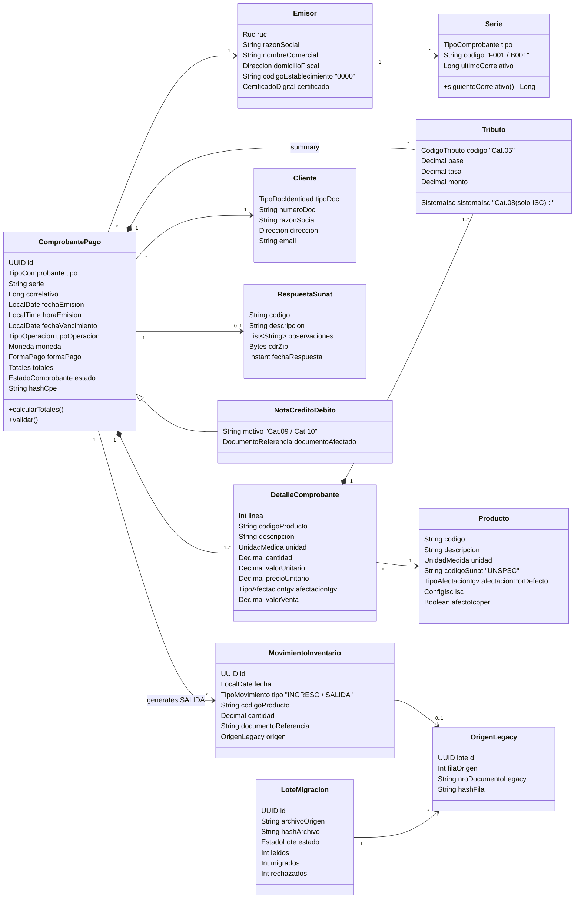
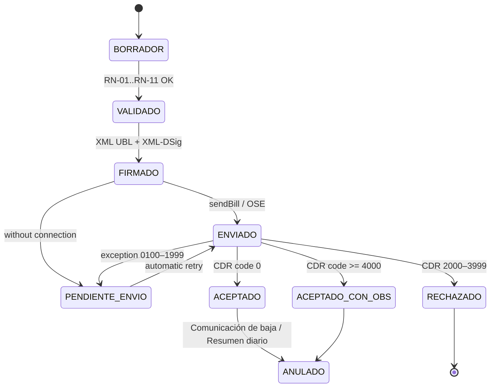

# 1. Domain Model and Contracts (DTOs / Schemas)

The model is split into **bounded contexts**. In the monolith they are packages; in the future vision each one can become a
microservice (see [02_ARQUITECTURA.md](02_ARQUITECTURA.md) §5).

| Context | Responsibility | Aggregate roots |
| :--- | :--- | :--- |
| **Billing (Facturación)** | Issue, sign, submit and void documents | `ComprobantePago`, `ResumenDiario`, `ComunicacionBaja` |
| **Catalogs and Master Data** | Issuer, customers, products, series, SUNAT catalogs | `Emisor`, `Cliente`, `Producto`, `Serie` |
| **Inventory** | Warehouse movements (inventory ledger / Kardex) | `MovimientoInventario` |
| **Migration** | Import legacy data without losing traceability | `LoteMigracion` |

## 1. Domain class diagram

## 2. Entities

### 2.1 ComprobantePago (Aggregate Root — Factura `01` / Boleta `03`)

| Attribute | Type | Rule / Catalog | UBL 2.1 |
| :--- | :--- | :--- | :--- |
| `id` | UUID | Internal, not sent to SUNAT | — |
| `tipo` | `TipoComprobante` | Cat. 01: `01` Factura, `03` Boleta, `07` NC, `08` ND | `cbc:InvoiceTypeCode` |
| `serie` | String(4) | RN-03 | part of `cbc:ID` |
| `correlativo` | Long 1..99999999 | RN-04, assigned by the system | part of `cbc:ID` |
| `fechaEmision` / `horaEmision` | Date / Time | RN-05 | `cbc:IssueDate` / `cbc:IssueTime` |
| `fechaVencimiento` | Optional Date | Mandatory if payment method = Crédito | `cbc:DueDate` |
| `tipoOperacion` | `TipoOperacion` | Cat. 51 (`0101` internal sale) | `cbc:InvoiceTypeCode/@listID` |
| `moneda` | `Moneda` | Cat. 02 / ISO 4217 (`PEN`, `USD`) | `cbc:DocumentCurrencyCode` |
| `formaPago` | `FormaPago` | `Contado` / `Credito` + installments | `cac:PaymentTerms` |
| `emisor` | `Emisor` | RN-01 | `cac:AccountingSupplierParty` |
| `cliente` | `Cliente` | RN-02, RN-10 | `cac:AccountingCustomerParty` |
| `detalles` | List ≥ 1 | — | `cac:InvoiceLine` |
| `tributos` | List `Tributo` | Sum of lines by Cat. 05 code | `cac:TaxTotal/cac:TaxSubtotal` |
| `totales` | `Totales` | RN-08 | `cac:LegalMonetaryTotal` |
| `leyendas` | List | Cat. 52 (`1000` = amount in words) | `cbc:Note/@languageLocaleID` |
| `estado` | `EstadoComprobante` | State machine §5 | — |
| `hashCpe` | String | XML digital signature digest | `ds:DigestValue` |

### 2.2 DetalleComprobante (Document Line)

| Attribute | Type | Rule | UBL 2.1 |
| :--- | :--- | :--- | :--- |
| `linea` | Int ≥ 1 | Consecutive order number | `cac:InvoiceLine/cbc:ID` |
| `cantidad` | Decimal(12,10) > 0 | — | `cbc:InvoicedQuantity` |
| `unidad` | `UnidadMedida` | Cat. 03 (UN/ECE Rec. 20: `NIU`, `KGM`, `ZZ`…) | `cbc:InvoicedQuantity/@unitCode` |
| `descripcion` | String(1..500) | — | `cac:Item/cbc:Description` |
| `codigoProducto` | String(30) | Internal product code | `cac:Item/cac:SellersItemIdentification/cbc:ID` |
| `valorUnitario` | Decimal(12,10) | Without taxes (unit value) | `cac:Price/cbc:PriceAmount` |
| `precioUnitario` | Decimal(12,10) | With taxes (unit price); Cat. 16 `01` | `cac:PricingReference/cac:AlternativeConditionPrice` |
| `afectacionIgv` | `TipoAfectacionIgv` | Cat. 07 | `cac:TaxCategory/cbc:TaxExemptionReasonCode` |
| `valorVenta` | Decimal(12,2) | `cantidad × valorUnitario − discounts` | `cbc:LineExtensionAmount` |
| `tributos` | List `Tributo` | Mandatory IGV; ISC / ICBPER depending on product | `cac:InvoiceLine/cac:TaxTotal` |

### 2.3 Tributo (Tax Value Object)

| Attribute | Rule | UBL 2.1 |
| :--- | :--- | :--- |
| `codigo` | Cat. 05: `1000` IGV, `2000` ISC, `7152` ICBPER, `9997` Exonerado, `9998` Inafecto, `9995` Exportación, `9996` Gratuito | `cac:TaxScheme/cbc:ID` (+ `cbc:Name`, `cbc:TaxTypeCode`) |
| `base` | Line taxable base amount | `cbc:TaxableAmount` |
| `tasa` | IGV 18 %; ISC according to system; ICBPER fixed amount per bag | `cbc:Percent` / `cbc:PerUnitAmount` |
| `monto` | Calculated tax amount (RN-07) | `cbc:TaxAmount` |
| `sistemaIsc` | **Cat. 08** — only if `codigo = 2000`: `01` Sistema al valor, `02` Aplicación del monto fijo, `03` Sistema de precios de venta al público | `cac:TaxCategory/cbc:TierRange` |

### 2.4 Emisor, Cliente, Producto, Serie

- **Emisor**: `ruc` (RN-01), `razonSocial`, `domicilioFiscal` with ubigeo (INEI), `codigoEstablecimiento` (`0000` = fiscal domicile), digital certificate (`.pfx`), secondary SOL credentials or OSE.
- **Cliente**: `tipoDoc` (Cat. 06: `6` RUC, `1` DNI, `4` Carné de extranjería, `7` Pasaporte, `0` No domiciliado, `-` Varios), `numeroDoc` (RN-02), `razonSocial`, `direccion`, `email`.
- **Producto**: internal `codigo`, `descripcion`, `unidad` (Cat. 03), `codigoSunat` (Cat. 25, UNSPSC), `afectacionPorDefecto` (Cat. 07), ISC configuration (Cat. 08 + rate), `afectoIcbper` (plastic bags).
- **Serie**: belongs to an issuer and document type; manages sequential numbering with transactional locking (RN-04).

### 2.5 MovimientoInventario and Migration

- **MovimientoInventario** (Kardex, N-02): `fecha`, `tipo` (`INGRESO`/`SALIDA`), `codigoProducto`, `cantidad`, `documentoReferencia`, `origen` (`SISTEMA` or `OrigenLegacy`). Every accepted sale generates a `SALIDA`.
- **LoteMigracion**: a legacy import execution batch. States: `CARGADO → VALIDADO → MIGRADO | CON_ERRORES | REVERTIDO`.
- **OrigenLegacy**: traceability stamp on every migrated record (`loteId`, `filaOrigen`, `nroDocumentoLegacy`, `hashFila` SHA-256 of the original row).

## 3. SUNAT Catalogs as Value Objects

Each catalog is a closed type; a value outside the catalog cannot be instantiated (it fails at constructor validation, not at the database level).

| Value Object | Catalog | Minimum values supported in Phase 1 |
| :--- | :--- | :--- |
| `TipoComprobante` | 01 | `01` Factura, `03` Boleta, `07` Nota de Crédito, `08` Nota de Débito |
| `Moneda` | 02 | `PEN`, `USD` |
| `UnidadMedida` | 03 | `NIU`, `KGM`, `LTR`, `BX`, `ZZ`, … |
| `CodigoTributo` | 05 | `1000` (IGV), `2000` (ISC), `7152` (ICBPER), `9995`–`9998` |
| `TipoDocIdentidad` | 06 | `0`, `1` (DNI), `4`, `6` (RUC), `7`, `-` |
| `TipoAfectacionIgv` | 07 | `10` Gravado - Operación Onerosa, `20` Exonerado, `30` Inafecto, `40` Exportación, `11`–`17`, `21`, `31`–`36` gratuitous |
| `SistemaIsc` | **08** | `01` (Al valor), `02` (Monto fijo), `03` (PVP) |
| `MotivoNotaCredito` / `MotivoNotaDebito` | 09 / 10 | `01` Anulación de la operación, `07` Devolución por ítem, … |
| `TipoPrecio` | 16 | `01` Precio unitario, `02` Valor referencial (gratuitas) |
| `TipoOperacion` | 51 | `0101` Venta interna |
| `Leyenda` | 52 | `1000` Monto en letras, `1002` Transferencia gratuita |

### 3.1 Why Catalog 08 is critical

ISC (Impuesto Selectivo al Consumo) levies products that a wholesale grocery business routinely sells: **beer, liquor, sodas and sweetened drinks, cigarettes**. Catalog 08 defines **how** that ISC is computed, and the result changes the base amount for IGV:

| Code | System | Line formula |
| :--- | :--- | :--- |
| `01` | Sistema al valor | `ISC = valorVenta × tasa%` |
| `02` | Aplicación del monto fijo | `ISC = cantidad × montoFijo` |
| `03` | Sistema de precios de venta al público | `ISC = (PVP sugerido × cantidad / (1 + IGV)) × tasa%` |

Because ISC forms part of the taxable base for IGV (`baseIGV = valorVenta + ISC`), an error in Catalog 08 propagates directly to IGV, totals, and XML hash; SUNAT/OSE will reject the document for amount inconsistency.

## 4. Business and Validation Rules (RN)

| ID | Rule | Source | Returned error code |
| :--- | :--- | :--- | :--- |
| RN-01 | Issuer RUC: 11 digits, prefix `10`, `15`, `16`, `17` or `20`, modulo 11 check digit (weights 5,4,3,2,7,6,5,4,3,2), ACTIVO state and HABIDO condition | N-01 | `RUC_EMISOR_INVALIDO` |
| RN-02 | Customer document according to Cat. 06: RUC = RN-01; DNI = 8 digits | N-01, N-04 | `DOC_CLIENTE_INVALIDO` |
| RN-03 | Series: Factura `F` + 3 alphanumerics; Boleta `B` + 3 alphanumerics; NC/ND use the affected document series. `cbc:ID` in UBL 2.1 Peru format `an..13` and pattern `[FB][A-Z0-9]{3}-[0-9]{1,8}` (e.g. `F001-1`) | N-05 | `SERIE_INVALIDA` |
| RN-04 | Unique consecutive sequence number per series without gaps; assigned by the system, **never** taken from the legacy system | N-01 | `CORRELATIVO_DUPLICADO` |
| RN-05 | Issue date must not be in the future and must be within the maximum submission window allowed by regulation | N-01 | `FECHA_FUERA_DE_PLAZO` |
| RN-06 | Factura requires a customer with RUC (except export); Boleta requires DNI/document if the total exceeds the statutory threshold (S/ 700) | N-01 | `CLIENTE_REQUERIDO` |
| RN-07 | Calculation per line: `ISC` according to Cat. 08 → `baseIGV = valorVenta + ISC` → `IGV = baseIGV × 18 %` (only if Cat. 07 = gravado) → `ICBPER = cantidad × current statutory rate` | N-04 | `MONTOS_INCONSISTENTES` |
| RN-08 | Totales: `LineExtensionAmount = Σ valorVenta − global discounts affecting base (Cat. 53 '02')`; `TaxInclusiveAmount = LineExtension + Σ taxes`; `PayableAmount = TaxInclusive − discounts not affecting base ('03') + charges − prepayments`; rounding to 2 decimals with ±1 cent tolerance | N-05 | `TOTALES_INCONSISTENTES` |
| RN-09 | Currency other than PEN requires exchange rate | N-04 | `TIPO_CAMBIO_REQUERIDO` |
| RN-10 | Payment terms `Credito` require due date and installments whose sum equals net pending payable amount | N-05 | `CUOTAS_INVALIDAS` |
| RN-11 | The XML must validate against `UBL-Invoice-2.1.xsd` and comply with the UBL 2.1 Peru customization (`CustomizationID` 2.0, `PE:SUNAT` attributes, mandatory elements from matrix 04) before being digitally signed | T-01, N-05 | `XML_NO_VALIDA_XSD` |
| RN-12 | An `ACEPTADO` document is immutable; it can only be adjusted via NC/ND or voided via communication of baja | N-01 | `COMPROBANTE_INMUTABLE` |
| RN-13 | Every migrated record preserves `OrigenLegacy`; Σ legacy quantities = Σ migrated quantities per product | Assignment §2 | `RECONCILIACION_FALLIDA` |

## 5. Document State Machine

A `RECHAZADO` document is never resent: its sequence number is permanently consumed, and a new document must be issued.

## 6. Legacy Data Migration Strategy

**Key architectural decision:** records from the basic software are **warehouse movements**, not electronic invoices. One
cannot (and must not) emit retroactive electronic invoices with historical dates or reuse the informal `nro_documento` as a
SUNAT sequence number (which would violate RN-04 and RN-05). Therefore, legacy records are migrated into the **Kardex** and the
**Product Master**.

| Legacy field | Destination | Transformation rule |
| :--- | :--- | :--- |
| `fecha` | `MovimientoInventario.fecha` | Parsing of detected formats (`dd/MM/yyyy`, `yyyy-MM-dd`…) into ISO-8601; invalid date → rejected row with reason |
| `ingreso` | `MovimientoInventario(tipo=INGRESO, cantidad)` | If `ingreso > 0`; numeric ≥ 0 |
| `salida` | `MovimientoInventario(tipo=SALIDA, cantidad)` | If `salida > 0`; a row with both inbound and outbound generates 2 movements |
| `producto` | `Producto` (code, description, unit) | Text normalization (uppercase, spaces); deduplication by similarity; new internal code; inferred Cat. 03 unit or `NIU` default, flagged for review |
| `nro_documento` | `MovimientoInventario.documentoReferencia` & `OrigenLegacy.nroDocumentoLegacy` | Preserved **as is** as historical reference, never used as series/sequence number |
| (full row) | `OrigenLegacy` | `hashFila` SHA-256 + `filaOrigen` + `loteId` |

Process: **Extract → Staging → Validate → Transform → Load → Reconcile** (idempotent: re-running a batch with the same
`hashArchivo` will not duplicate data). See UC-12 and `/migraciones` in the API contract.

## 7. Contracts (DTOs / Schemas)

DTOs form the boundary between the View/Controller and the domain; entities are **never** exposed. The formal definition (JSON Schema
within OpenAPI 3.0.3) is located in [`specs/03_CONTRATOS_API.yaml`](../specs/03_CONTRATOS_API.yaml) → `components/schemas`.

| DTO | Direction | Maps to | Notes |
| :--- | :--- | :--- | :--- |
| `EmitirComprobanteRequest` | input | `ComprobantePago` | Does not include sequence number or totals: calculated by domain |
| `ItemRequest` | input | `DetalleComprobante` | Accepts `valorUnitario` **or** `precioUnitario` (mutually exclusive) |
| `ClienteDto` | input/output | `Cliente` | |
| `ComprobanteResponse` | output | `ComprobantePago` + `RespuestaSunat` | Includes totals, hash, status, and XML/CDR/PDF links |
| `TotalesDto` / `TributoDto` | output | `Totales` / `Tributo` | |
| `NotaRequest` | input | `NotaCreditoDebito` | Requires reference document and Cat. 09/10 reason |
| `BajaRequest` | input | `ComunicacionBaja` | |
| `LoteMigracionResponse` | output | `LoteMigracion` | Counts and reconciliation report |
| `ErrorResponse` | output | — | `codigo` (RN-xx or SUNAT error code), `mensaje`, `campo` |
