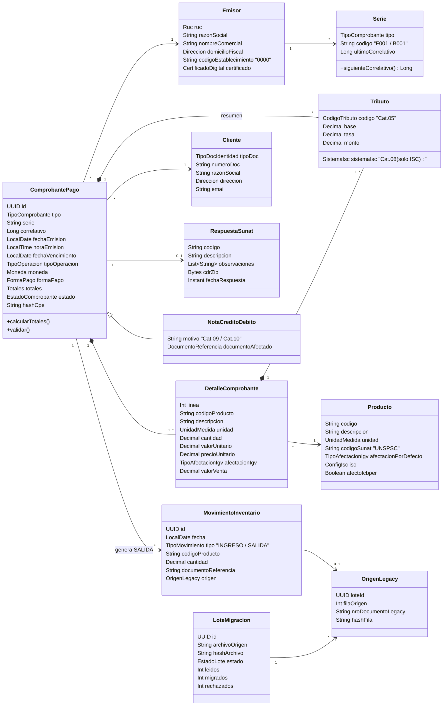
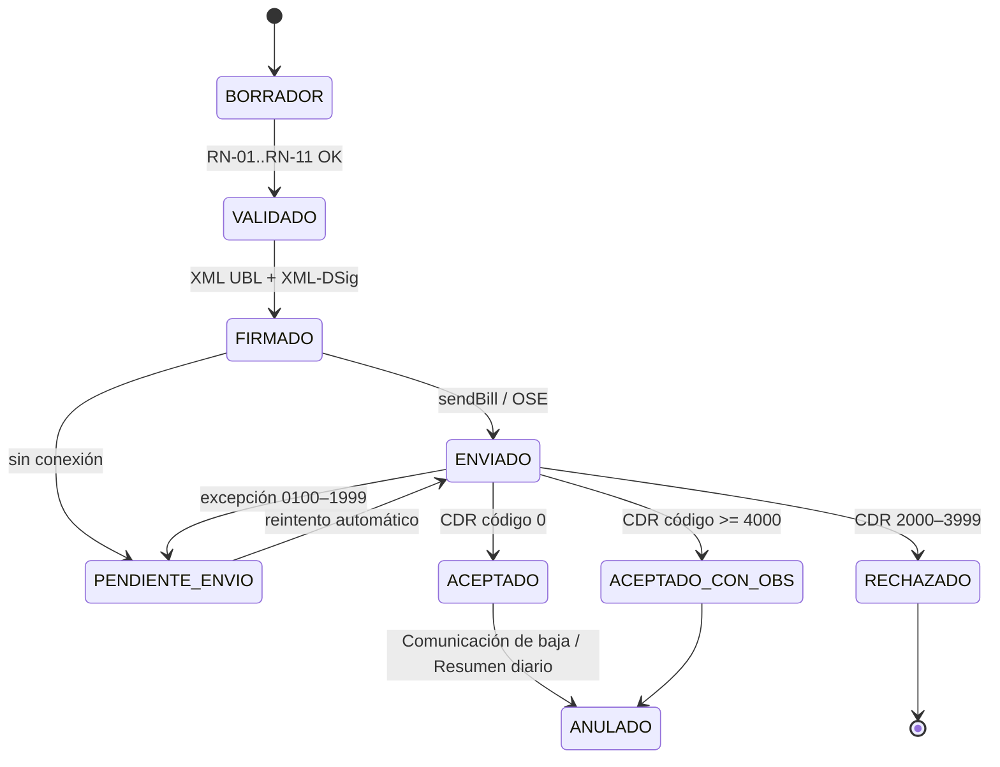

# 1. Modelo de Dominio y Contratos (DTOs / Schemas)

El modelo se divide en **contextos acotados** (bounded contexts). En el monolito son paquetes; en la visión futura cada uno
puede convertirse en un microservicio (ver [02_ARQUITECTURA.md](02_ARQUITECTURA.md) §5).

| Contexto | Responsabilidad | Agregados raíz |
| :--- | :--- | :--- |
| **Facturación** | Emitir, firmar, enviar y anular comprobantes | `ComprobantePago`, `ResumenDiario`, `ComunicacionBaja` |
| **Catálogos y Maestros** | Emisor, clientes, productos, series, catálogos SUNAT | `Emisor`, `Cliente`, `Producto`, `Serie` |
| **Inventario** | Movimientos de almacén (kardex) | `MovimientoInventario` |
| **Migración** | Importar el legado sin perder trazabilidad | `LoteMigracion` |

## 1. Diagrama de clases del dominio

## 2. Entidades

### 2.1 ComprobantePago (agregado raíz — Factura `01` / Boleta `03`)

| Atributo | Tipo | Regla / Catálogo | UBL 2.1 |
| :--- | :--- | :--- | :--- |
| `id` | UUID | Interno, no se envía a SUNAT | — |
| `tipo` | `TipoComprobante` | Cat. 01: `01` Factura, `03` Boleta, `07` NC, `08` ND | `cbc:InvoiceTypeCode` |
| `serie` | String(4) | RN-03 | parte de `cbc:ID` |
| `correlativo` | Long 1..99999999 | RN-04, asignado por el sistema | parte de `cbc:ID` |
| `fechaEmision` / `horaEmision` | Fecha / Hora | RN-05 | `cbc:IssueDate` / `cbc:IssueTime` |
| `fechaVencimiento` | Fecha opcional | Obligatoria si forma de pago = Crédito | `cbc:DueDate` |
| `tipoOperacion` | `TipoOperacion` | Cat. 51 (`0101` venta interna) | `cbc:InvoiceTypeCode/@listID` |
| `moneda` | `Moneda` | Cat. 02 / ISO 4217 (`PEN`, `USD`) | `cbc:DocumentCurrencyCode` |
| `formaPago` | `FormaPago` | `Contado` / `Credito` + cuotas | `cac:PaymentTerms` |
| `emisor` | `Emisor` | RN-01 | `cac:AccountingSupplierParty` |
| `cliente` | `Cliente` | RN-02, RN-10 | `cac:AccountingCustomerParty` |
| `detalles` | Lista ≥ 1 | — | `cac:InvoiceLine` |
| `tributos` | Lista `Tributo` | Suma de líneas por código Cat. 05 | `cac:TaxTotal/cac:TaxSubtotal` |
| `totales` | `Totales` | RN-08 | `cac:LegalMonetaryTotal` |
| `leyendas` | Lista | Cat. 52 (`1000` = monto en letras) | `cbc:Note/@languageLocaleID` |
| `estado` | `EstadoComprobante` | Máquina de estados §5 | — |
| `hashCpe` | String | Digest de la firma XML | `ds:DigestValue` |

### 2.2 DetalleComprobante

| Atributo | Tipo | Regla | UBL 2.1 |
| :--- | :--- | :--- | :--- |
| `linea` | Int ≥ 1 | Consecutivo | `cac:InvoiceLine/cbc:ID` |
| `cantidad` | Decimal(12,10) > 0 | — | `cbc:InvoicedQuantity` |
| `unidad` | `UnidadMedida` | Cat. 03 (UN/ECE Rec. 20: `NIU`, `KGM`, `ZZ`…) | `cbc:InvoicedQuantity/@unitCode` |
| `descripcion` | String(1..500) | — | `cac:Item/cbc:Description` |
| `codigoProducto` | String(30) | Código interno | `cac:Item/cac:SellersItemIdentification/cbc:ID` |
| `valorUnitario` | Decimal(12,10) | Sin tributos | `cac:Price/cbc:PriceAmount` |
| `precioUnitario` | Decimal(12,10) | Con tributos; Cat. 16 `01` | `cac:PricingReference/cac:AlternativeConditionPrice` |
| `afectacionIgv` | `TipoAfectacionIgv` | Cat. 07 | `cac:TaxCategory/cbc:TaxExemptionReasonCode` |
| `valorVenta` | Decimal(12,2) | `cantidad × valorUnitario − descuentos` | `cbc:LineExtensionAmount` |
| `tributos` | Lista `Tributo` | IGV obligatorio; ISC / ICBPER según producto | `cac:InvoiceLine/cac:TaxTotal` |

### 2.3 Tributo (value object)

| Atributo | Regla | UBL 2.1 |
| :--- | :--- | :--- |
| `codigo` | Cat. 05: `1000` IGV, `2000` ISC, `7152` ICBPER, `9997` Exonerado, `9998` Inafecto, `9995` Exportación, `9996` Gratuito | `cac:TaxScheme/cbc:ID` (+ `cbc:Name`, `cbc:TaxTypeCode`) |
| `base` | Base imponible de la línea | `cbc:TaxableAmount` |
| `tasa` | IGV 18 %; ISC según sistema; ICBPER monto fijo por bolsa | `cbc:Percent` / `cbc:PerUnitAmount` |
| `monto` | Calculado (RN-07) | `cbc:TaxAmount` |
| `sistemaIsc` | **Cat. 08** — solo si `codigo = 2000`: `01` Sistema al valor, `02` Aplicación del monto fijo, `03` Sistema de precios de venta al público | `cac:TaxCategory/cbc:TierRange` |

### 2.4 Emisor, Cliente, Producto, Serie

- **Emisor**: `ruc` (RN-01), `razonSocial`, `domicilioFiscal` con ubigeo (INEI), `codigoEstablecimiento` (`0000` = domicilio fiscal), certificado digital (`.pfx`), credenciales SOL secundarias u OSE.
- **Cliente**: `tipoDoc` (Cat. 06: `6` RUC, `1` DNI, `4` Carné de extranjería, `7` Pasaporte, `0` No domiciliado, `-` Varios), `numeroDoc` (RN-02), `razonSocial`, `direccion`, `email`.
- **Producto**: `codigo` interno, `descripcion`, `unidad` (Cat. 03), `codigoSunat` (Cat. 25, UNSPSC), `afectacionPorDefecto` (Cat. 07), configuración ISC (Cat. 08 + tasa), `afectoIcbper` (bolsas plásticas).
- **Serie**: pertenece a un emisor y tipo de comprobante; controla el correlativo con bloqueo transaccional (RN-04).

### 2.5 MovimientoInventario y migración

- **MovimientoInventario** (kardex, N-02): `fecha`, `tipo` (`INGRESO`/`SALIDA`), `codigoProducto`, `cantidad`, `documentoReferencia`, `origen` (`SISTEMA` u `OrigenLegacy`). Toda venta aceptada genera una `SALIDA`.
- **LoteMigracion**: una ejecución de importación del legado. Estados: `CARGADO → VALIDADO → MIGRADO | CON_ERRORES | REVERTIDO`.
- **OrigenLegacy**: sello de trazabilidad en cada registro migrado (`loteId`, `filaOrigen`, `nroDocumentoLegacy`, `hashFila` SHA-256 de la fila original).

## 3. Catálogos SUNAT como Value Objects

Cada catálogo es un tipo cerrado; un valor fuera de catálogo no puede construirse (falla en el constructor, no en la base de datos).

| Value Object | Catálogo | Valores mínimos soportados en fase 1 |
| :--- | :--- | :--- |
| `TipoComprobante` | 01 | `01`, `03`, `07`, `08` |
| `Moneda` | 02 | `PEN`, `USD` |
| `UnidadMedida` | 03 | `NIU`, `KGM`, `LTR`, `BX`, `ZZ`, … |
| `CodigoTributo` | 05 | `1000`, `2000`, `7152`, `9995`–`9998` |
| `TipoDocIdentidad` | 06 | `0`, `1`, `4`, `6`, `7`, `-` |
| `TipoAfectacionIgv` | 07 | `10` Gravado onerosa, `20` Exonerado onerosa, `30` Inafecto onerosa, `40` Exportación, `11`–`17`, `21`, `31`–`36` gratuitas |
| `SistemaIsc` | **08** | `01`, `02`, `03` |
| `MotivoNotaCredito` / `MotivoNotaDebito` | 09 / 10 | `01` Anulación de la operación, `07` Devolución por ítem, … |
| `TipoPrecio` | 16 | `01` Precio unitario, `02` Valor referencial (gratuitas) |
| `TipoOperacion` | 51 | `0101` Venta interna |
| `Leyenda` | 52 | `1000` Monto en letras, `1002` Transferencia gratuita |

### 3.1 Por qué el Catálogo 08 es clave

El ISC (Impuesto Selectivo al Consumo) grava productos que un mayorista de abarrotes sí vende: **cervezas, licores, gaseosas y
bebidas azucaradas, cigarrillos**. El Catálogo 08 define **cómo** se calcula ese ISC, y el resultado cambia la base del IGV:

| Código | Sistema | Fórmula de la línea |
| :--- | :--- | :--- |
| `01` | Sistema al valor | `ISC = valorVenta × tasa%` |
| `02` | Aplicación del monto fijo | `ISC = cantidad × montoFijo` |
| `03` | Sistema de precios de venta al público | `ISC = (PVP sugerido × cantidad / (1 + IGV)) × tasa%` |

Como el ISC forma parte de la base imponible del IGV (`baseIGV = valorVenta + ISC`), un error en el Catálogo 08 se propaga a IGV,
totales y hash; SUNAT/OSE rechaza el comprobante por inconsistencia de montos.

## 4. Reglas de negocio y validación (RN)

| ID | Regla | Origen | Error devuelto |
| :--- | :--- | :--- | :--- |
| RN-01 | RUC del emisor: 11 dígitos, prefijo `10`, `15`, `16`, `17` o `20`, dígito verificador módulo 11 (pesos 5,4,3,2,7,6,5,4,3,2), estado ACTIVO y condición HABIDO | N-01 | `RUC_EMISOR_INVALIDO` |
| RN-02 | Documento del cliente según Cat. 06: RUC = RN-01; DNI = 8 dígitos | N-01, N-04 | `DOC_CLIENTE_INVALIDO` |
| RN-03 | Serie: Factura `F` + 3 alfanuméricos; Boleta `B` + 3 alfanuméricos; NC/ND usan la serie del documento afectado. `cbc:ID` con formato UBL 2.1 Perú `an..13` y patrón `[FB][A-Z0-9]{3}-[0-9]{1,8}` (p. ej. `F001-1`) | N-05 | `SERIE_INVALIDA` |
| RN-04 | Correlativo único, consecutivo por serie, sin saltos; lo asigna el sistema, **nunca** se toma del legado | N-01 | `CORRELATIVO_DUPLICADO` |
| RN-05 | Fecha de emisión no futura y dentro del plazo máximo de envío vigente (parámetro configurable) | N-01 | `FECHA_FUERA_DE_PLAZO` |
| RN-06 | Factura exige cliente con RUC (salvo exportación); Boleta exige DNI/doc si el importe supera el umbral vigente (S/ 700) | N-01 | `CLIENTE_REQUERIDO` |
| RN-07 | Cálculo por línea: `ISC` según Cat. 08 → `baseIGV = valorVenta + ISC` → `IGV = baseIGV × 18 %` (solo si Cat. 07 = gravado) → `ICBPER = cantidad × tasa vigente` | N-04 | `MONTOS_INCONSISTENTES` |
| RN-08 | Totales: `LineExtensionAmount = Σ valorVenta − descuentos globales que afectan la base (Cat. 53 '02')`; `TaxInclusiveAmount = LineExtension + Σ tributos`; `PayableAmount = TaxInclusive − descuentos que no afectan la base ('03') + cargos − anticipos`; redondeo a 2 decimales con tolerancia ±1 | N-05 | `TOTALES_INCONSISTENTES` |
| RN-09 | Moneda distinta de PEN requiere tipo de cambio | N-04 | `TIPO_CAMBIO_REQUERIDO` |
| RN-10 | Forma de pago `Credito` exige fecha de vencimiento y cuotas cuya suma = monto neto pendiente | N-05 | `CUOTAS_INVALIDAS` |
| RN-11 | El XML debe validar contra `UBL-Invoice-2.1.xsd` y cumplir la personalización UBL 2.1 Perú (`CustomizationID` 2.0, atributos `PE:SUNAT`, elementos obligatorios de la matriz 04) antes de firmarse | T-01, N-05 | `XML_NO_VALIDA_XSD` |
| RN-12 | Un comprobante `ACEPTADO` es inmutable; solo se corrige con NC/ND o se da de baja | N-01 | `COMPROBANTE_INMUTABLE` |
| RN-13 | Cada registro migrado conserva `OrigenLegacy`; Σ cantidades legadas = Σ cantidades migradas por producto | Enunciado §2 | `RECONCILIACION_FALLIDA` |

## 5. Máquina de estados del comprobante

Un `RECHAZADO` no se reenvía: su correlativo queda consumido y se emite uno nuevo.

## 6. Estrategia de migración de datos legados

**Decisión clave:** los registros del software básico son **movimientos de almacén**, no comprobantes electrónicos. No se
puede (ni se debe) generar facturas electrónicas retroactivas con fechas antiguas ni reutilizar el `nro_documento` informal como
correlativo SUNAT (rompería RN-04 y RN-05). Por eso el legado se migra al **kardex** y al **maestro de productos**.

| Campo legado | Destino | Regla de transformación |
| :--- | :--- | :--- |
| `fecha` | `MovimientoInventario.fecha` | Parseo de formatos detectados (`dd/MM/yyyy`, `yyyy-MM-dd`…) a ISO-8601; fecha inválida → fila rechazada con motivo |
| `ingreso` | `MovimientoInventario(tipo=INGRESO, cantidad)` | Si `ingreso > 0`; numérico ≥ 0 |
| `salida` | `MovimientoInventario(tipo=SALIDA, cantidad)` | Si `salida > 0`; una fila con ingreso y salida genera 2 movimientos |
| `producto` | `Producto` (código, descripción, unidad) | Normalización de texto (mayúsculas, espacios); deduplicación por similitud; código interno nuevo; unidad Cat. 03 inferida o `NIU` por defecto, marcada para revisión |
| `nro_documento` | `MovimientoInventario.documentoReferencia` y `OrigenLegacy.nroDocumentoLegacy` | Se conserva **tal cual** como referencia histórica, sin usarse como serie/correlativo |
| (fila completa) | `OrigenLegacy` | `hashFila` SHA-256 + `filaOrigen` + `loteId` |

Proceso: **Extraer → Staging → Validar → Transformar → Cargar → Reconciliar** (idempotente: re-ejecutar un lote con el mismo
`hashArchivo` no duplica datos). Ver CU-12 y `/migraciones` en la API.

## 7. Contratos (DTOs / Schemas)

Los DTOs son la frontera entre la Vista/Controlador y el dominio; **nunca** se exponen entidades. La definición formal (JSON Schema
dentro de OpenAPI 3.0.3) vive en [`specs/03_CONTRATOS_API.yaml`](../specs/03_CONTRATOS_API.yaml) → `components/schemas`.

| DTO | Dirección | Mapea a | Notas |
| :--- | :--- | :--- | :--- |
| `EmitirComprobanteRequest` | entrada | `ComprobantePago` | No incluye correlativo ni totales: los calcula el dominio |
| `ItemRequest` | entrada | `DetalleComprobante` | Acepta `valorUnitario` **o** `precioUnitario` (excluyentes) |
| `ClienteDto` | entrada/salida | `Cliente` | |
| `ComprobanteResponse` | salida | `ComprobantePago` + `RespuestaSunat` | Incluye totales, hash, estado y enlaces XML/CDR/PDF |
| `TotalesDto` / `TributoDto` | salida | `Totales` / `Tributo` | |
| `NotaRequest` | entrada | `NotaCreditoDebito` | Requiere documento de referencia y motivo Cat. 09/10 |
| `BajaRequest` | entrada | `ComunicacionBaja` | |
| `LoteMigracionResponse` | salida | `LoteMigracion` | Conteos y reporte de reconciliación |
| `ErrorResponse` | salida | — | `codigo` (RN-xx o código SUNAT), `mensaje`, `campo` |
