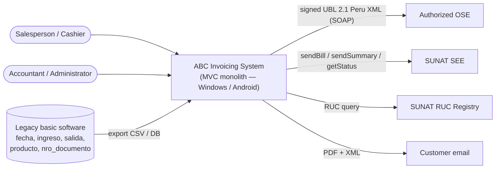
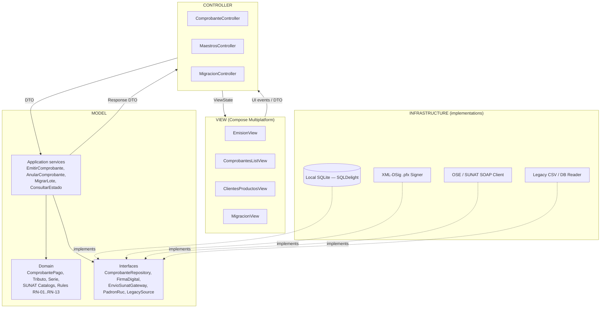
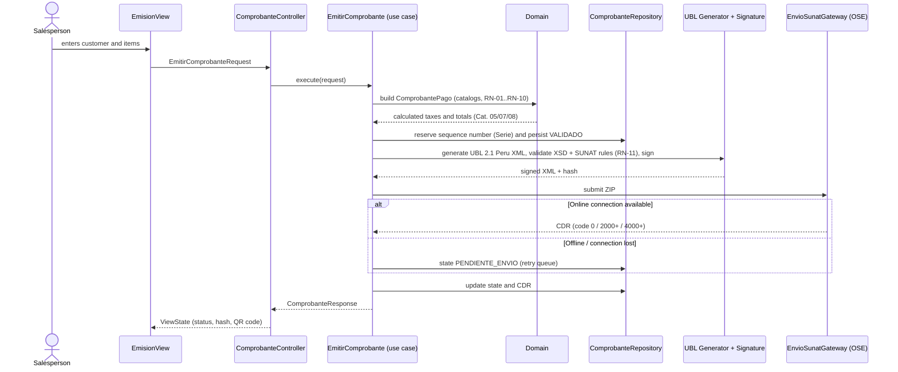
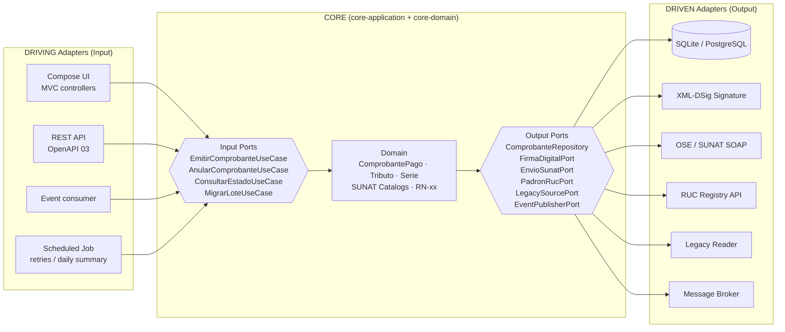
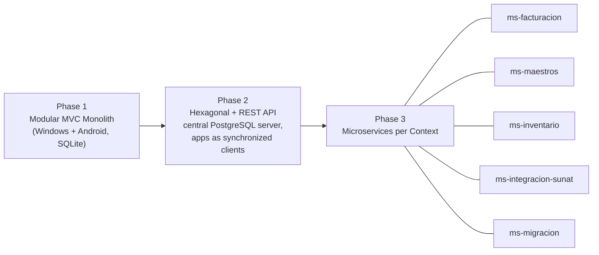
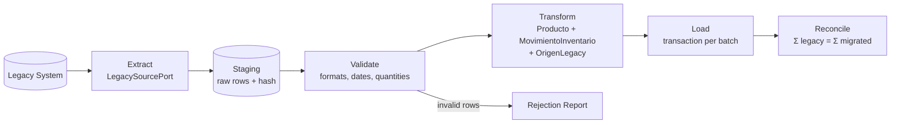
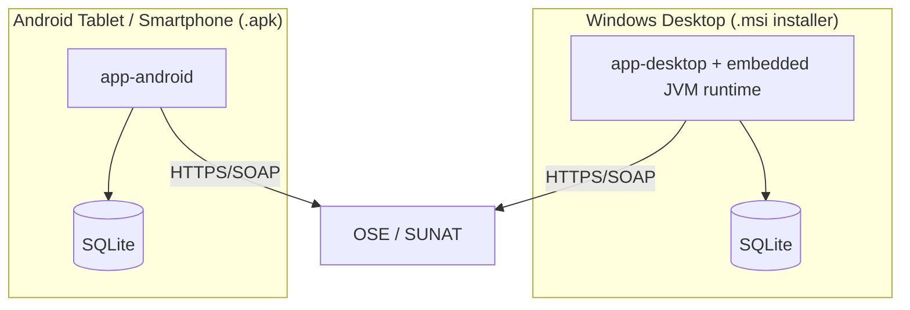

# 2. MVC Architecture Diagrams with a Hexagonal Vision

## 1. System Context (C4 — Level 1)



## 2. Base Vision: Clean Monolith with the MVC Pattern

The monolith is **a single executable** per platform. MVC organizes user interaction; the "M" is not an anemic model
tied to the database, but a domain core with services and repositories accessed through interfaces.



**Rules that keep the MVC "clean" (and prepare it for Hexagonal):**

1. **Dependency rule**: View → Controller → Services → Domain. The domain does not import anything from UI, SQL, SOAP or frameworks.
2. **Controllers** only translate UI events ↔ DTOs; they do not contain tax rules.
3. All I/O (database, digital signing, SUNAT/OSE, RUC registry, legacy import) is accessed **via interfaces** declared in the Model and implemented in Infrastructure.
4. **Entities never leave** the Model: the View receives DTOs/ViewState.
5. One module per bounded context (`facturacion`, `maestros`, `inventario`, `migracion`); they communicate only through public interfaces or domain events (`ComprobanteAceptado`).

### Module Structure (Multiplatform Gradle)

```text
abc-facturacion/
├── core-domain/          # Entities, value objects, SUNAT catalogs, RN-xx (pure Kotlin, zero external dependencies)
├── core-application/     # Use cases + ports (interfaces)                 (pure Kotlin)
├── adapters-persistence/ # SQLDelight (SQLite) → ComprobanteRepository, ...
├── adapters-sunat/       # UBL generator, XSD validator, XML-DSig signer, OSE/SUNAT SOAP client
├── adapters-legacy/      # Legacy basic software readers (CSV / DB)
├── app-ui/               # Views + Controllers (Compose Multiplatform)
├── app-desktop/          # main() Windows → MSI installer package
└── app-android/          # Android Activity → APK
```

## 3. Main Sequence Flow: Issue Factura



## 4. Future Vision: Hexagonal Architecture (Ports and Adapters)

The architectural migration **does not rewrite the domain**: the `core-*` packages already constitute the hexagon. The MVC Controllers become just another driving adapter, and new adapters (REST API, messaging) can be plugged in without touching the business core.



### Mapping MVC → Hexagonal

| Element in MVC Monolith | Role in Hexagonal Architecture | Required change upon migration |
| :--- | :--- | :--- |
| View + Controller | Driving / Input adapter | None; REST adapters are added alongside |
| Application services | Input ports (use cases) | None |
| Entities and business rules (RN) | Domain core | None |
| Repository and gateway interfaces | Output ports | None |
| SQLite, SOAP, digital signing, CSV | Driven / Output adapters | Implementations added (e.g., PostgreSQL, messaging broker) |

## 5. Evolutionary Roadmap to Microservices



- Each module (`facturacion / maestros / inventario / migracion`) maintains its own table schema from Phase 1 (no cross-context SQL joins), enabling independent database extraction.
- Cross-context communication is already handled through domain events (`ComprobanteAceptado` → `inventario` records the `SALIDA`); in Phase 3, `EventPublisherPort` shifts to an external message broker without modifying domain logic.
- `ms-integracion-sunat` concentrates XML generation, XSD validation, XML-DSig signing, and SOAP submission: it is the primary candidate for early extraction due to its distinct scaling requirements (month-end volume spikes).

## 6. Migration Module Architecture



## 7. Deployment and Cross-Platform Execution

| Requirement | Architectural Decision | Technical Rationale |
| :--- | :--- | :--- |
| Native Windows & Android execution | **Kotlin Multiplatform + Compose Multiplatform** | Single shared domain and UI codebase; compiles to a native Android APK and to a packaged Windows desktop JVM app bundled with its own runtime |
| MSI Installer | Compose Desktop plugin `nativeDistributions { targetFormats(TargetFormat.Msi) }` (using `jpackage` + WiX) | Produces a standard Windows `.msi` package with desktop shortcuts and clean uninstall support |
| Android APK | `assembleRelease` signed with corporate keystore | Direct enterprise deployment (sideloading outside Google Play) |
| Local persistence | SQLite via SQLDelight (runs natively on both platforms) | PostgreSQL does not run embedded on Android devices; reserved for central Phase 2 server |
| Digital signature | Encrypted `.pfx` certificate storage (Windows DPAPI / Android Keystore) | Private key is never persisted or transmitted in plaintext |
| Offline store operations | In-memory and persisted `PENDIENTE_ENVIO` queue with retries | Essential for retail locations experiencing intermittent internet connectivity |



## 8. Quality Attributes (Non-Functional Requirements)

| Quality Attribute | Architectural Scenario | Applied Tactic |
| :--- | :--- | :--- |
| Compliance | 100% of generated XML documents must validate against `UBL-Invoice-2.1.xsd` and UBL 2.1 Peru customization | Pre-signing XSD validation (RN-11) + automated test assertions against official SUNAT sample XMLs |
| Availability | Retail checkout counter operations must never stop during internet outages | Offline queuing (`PENDIENTE_ENVIO`) with exponential backoff retry worker |
| Data Integrity | Sequence numbers must never duplicate or skip numbers | Transactional row-level lock on `Serie` entity during issuance |
| Modifiability | Switch authorized OSE vendor in < 1 business day | `EnvioSunatPort` abstraction with pluggable adapter implementations |
| Traceability | Every migrated record must trace directly to its original legacy source row | `OrigenLegacy` metadata stamp + mathematical quantity reconciliation |
| Security | Digital certificate private keys and SOL credentials must remain protected | OS-level secure credential storage (DPAPI/Keystore), never stored in plaintext |
