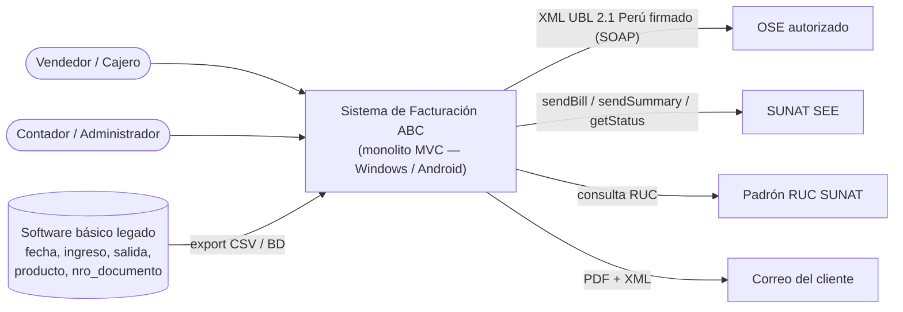
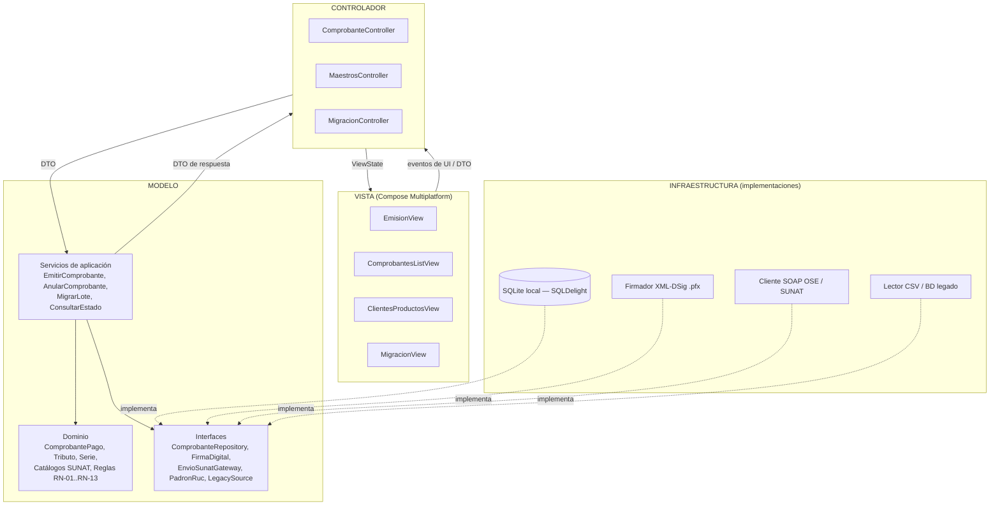
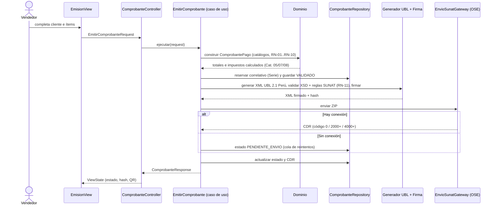
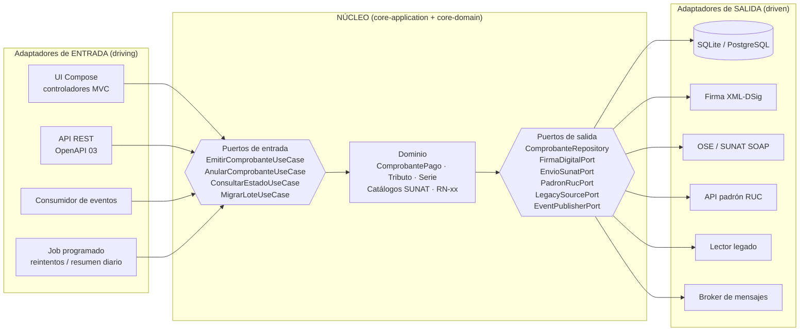
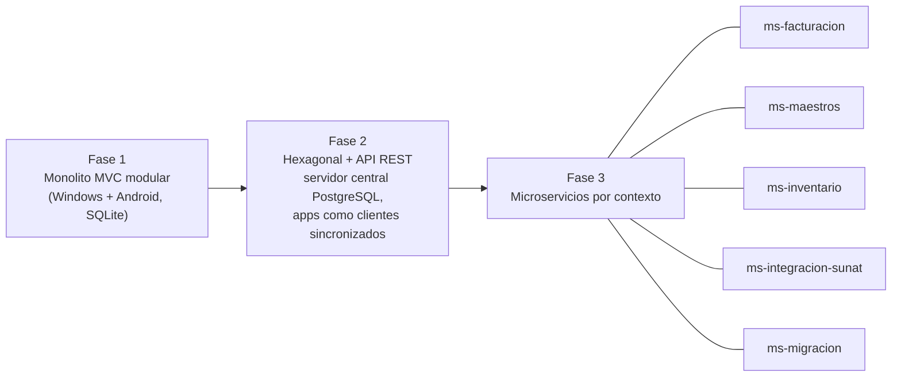
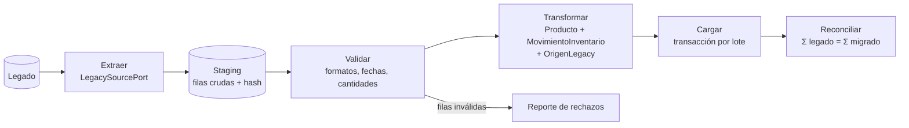
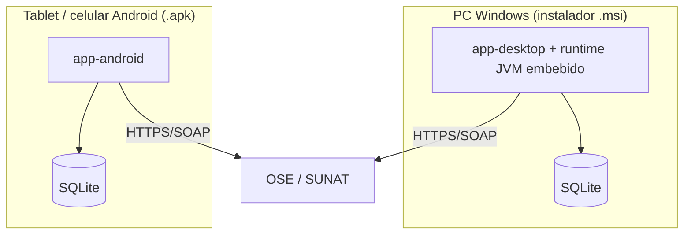

# 2. Diagramas de Arquitectura MVC con visión a Hexagonal

## 1. Contexto del sistema (C4 — nivel 1)



## 2. Visión base: monolito limpio con patrón MVC

El monolito es **un solo ejecutable** por plataforma. MVC organiza la interacción con el usuario; la "M" no es un modelo
anémico ligado a la base de datos, sino un núcleo de dominio con servicios y repositorios por interfaz.



**Reglas que hacen al MVC "limpio" (y preparan Hexagonal):**

1. **Regla de dependencia**: Vista → Controlador → Servicios → Dominio. El dominio no importa nada de UI, SQL, SOAP ni del framework.
2. Los **Controladores** solo traducen eventos de UI ↔ DTOs; no contienen reglas tributarias.
3. Toda E/S (base de datos, firma, SUNAT/OSE, padrón RUC, legado) se accede **por interfaz** declarada en el Modelo e implementada en Infraestructura.
4. Las **entidades nunca salen** del Modelo: la Vista recibe DTOs/ViewState.
5. Un módulo por contexto acotado (`facturacion`, `maestros`, `inventario`, `migracion`); se comunican solo por interfaces públicas o eventos de dominio (`ComprobanteAceptado`).

### Estructura de módulos (Gradle multiplataforma)

```text
abc-facturacion/
├── core-domain/          # Entidades, value objects, catálogos SUNAT, RN-xx  (Kotlin puro, sin dependencias)
├── core-application/     # Casos de uso + puertos (interfaces)                (Kotlin puro)
├── adapters-persistence/ # SQLDelight (SQLite) → ComprobanteRepository, ...
├── adapters-sunat/       # Generador UBL, validador XSD, firma XML-DSig, cliente SOAP OSE/SUNAT
├── adapters-legacy/      # Lectores del software básico (CSV / BD)
├── app-ui/               # Vistas + Controladores (Compose Multiplatform)
├── app-desktop/          # main() Windows → instalador MSI
└── app-android/          # Activity Android → APK
```

## 3. Flujo principal: emitir factura



## 4. Visión futura: arquitectura Hexagonal (Puertos y Adaptadores)

La migración **no reescribe el dominio**: los paquetes `core-*` ya son el hexágono. Los Controladores MVC pasan a ser un
adaptador de entrada más, y aparecen otros (REST, mensajería) sin tocar el núcleo.



### Correspondencia MVC → Hexagonal

| Elemento en el monolito MVC | Rol en Hexagonal | Cambio necesario al migrar |
| :--- | :--- | :--- |
| Vista + Controlador | Adaptador de entrada | Ninguno; se añaden adaptadores REST |
| Servicios de aplicación | Puertos de entrada (casos de uso) | Ninguno |
| Entidades y reglas RN | Dominio | Ninguno |
| Interfaces de repositorio/gateway | Puertos de salida | Ninguno |
| SQLite, SOAP, firma, CSV | Adaptadores de salida | Se añaden implementaciones (p. ej. PostgreSQL) |

## 5. Ruta de evolución a microservicios



- Cada módulo `facturacion / maestros / inventario / migracion` tiene su propio esquema de tablas desde la fase 1 (sin *joins* entre contextos), así puede extraerse con su base de datos.
- La comunicación entre contextos ya se hace por eventos de dominio (`ComprobanteAceptado` → `inventario` registra la SALIDA); en fase 3 el `EventPublisherPort` cambia a un broker sin modificar el dominio.
- `ms-integracion-sunat` concentra firma, XSD y envío: es el primer candidato a extraer porque escala distinto (picos de fin de mes).

## 6. Vista del módulo de migración



## 7. Despliegue y multiplataforma

| Requisito | Decisión | Justificación |
| :--- | :--- | :--- |
| Ejecución nativa Windows y Android | **Kotlin Multiplatform + Compose Multiplatform** | Una sola base de código de dominio y UI; en Android compila a APK nativo, en Windows a app de escritorio JVM empaquetada con su propio runtime |
| Instalador MSI | Plugin Compose Desktop `nativeDistributions { targetFormats(TargetFormat.Msi) }` (usa `jpackage` + WiX) | Genera un `.msi` estándar con acceso directo y desinstalador |
| APK Android | `assembleRelease` firmado con keystore de la empresa | Distribución directa (fuera de Play Store) |
| Persistencia local | SQLite vía SQLDelight (funciona en ambas plataformas) | PostgreSQL no corre nativamente en Android; se reserva para el servidor central de la fase 2 |
| Firma digital | Certificado `.pfx` almacenado cifrado (Windows DPAPI / Android Keystore) | El certificado nunca viaja en texto plano |
| Operación sin internet | Cola `PENDIENTE_ENVIO` con reintentos | Tiendas con conectividad intermitente |



## 8. Atributos de calidad

| Atributo | Escenario | Táctica |
| :--- | :--- | :--- |
| Conformidad | 100 % de XML generados validan contra `UBL-Invoice-2.1.xsd` y la personalización UBL 2.1 Perú | Validación XSD previa a firma (RN-11) + pruebas con XML de ejemplo SUNAT |
| Disponibilidad | Sin internet, la venta no se detiene | Cola de envío y reintentos |
| Integridad | No se repiten ni saltan correlativos | Bloqueo transaccional en `Serie` |
| Modificabilidad | Cambiar de OSE en < 1 día | `EnvioSunatPort` con un adaptador por proveedor |
| Trazabilidad | Todo registro migrado es rastreable a su fila de origen | `OrigenLegacy` + reconciliación |
| Seguridad | Certificado y credenciales SOL protegidos | Almacén seguro del SO, nunca en la BD en claro |
