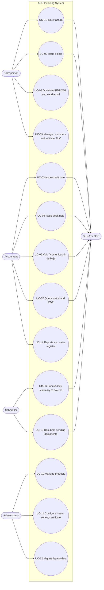

# 5. Use Cases

Source: standard features found in Peruvian electronic invoicing systems (e.g., Nubefact, DEMO environment) and common user complaints
(rejections due to rounding errors in totals, duplicate sequence numbers, connection drops, difficulty voiding documents). Each use case
links to business rules (RN), endpoints (EP), and statutory regulations (N).

## 1. Actors

| Actor | Description |
| :--- | :--- |
| Salesperson / Cashier | Issues boletas and facturas at the store point of sale (Windows or Android) |
| Administrator | Configures issuer details, series, digital certificate, users, and product catalog |
| Accountant | Monitors document statuses, voids documents, issues credit/debit notes, exports accounting registers |
| SUNAT / OSE | External tax administration / OSE system that validates documents and returns the CDR |
| Scheduler | Automated background worker process (retries, daily summary submission) |

## 2. Diagram

## 3. Use Case Catalog

| ID | Use Case | Actor | Priority | Business Rules | Endpoint |
| :--- | :--- | :--- | :---: | :--- | :--- |
| UC-01 | Issue factura | Salesperson | High | RN-01..RN-12 | EP-01 |
| UC-02 | Issue boleta de venta | Salesperson | High | RN-02..RN-08, RN-11 | EP-01 |
| UC-03 | Issue credit note (Cat. 09) | Accountant | High | RN-03, RN-07, RN-08, RN-12 | EP-05 |
| UC-04 | Issue debit note (Cat. 10) | Accountant | Medium | RN-03, RN-07, RN-08 | EP-05 |
| UC-05 | Void document (comunicación de baja) | Accountant | High | RN-12 | EP-06 |
| UC-06 | Submit daily summary of boletas | Scheduler | High | RN-05 | EP-07 |
| UC-07 | Query status and CDR | Accountant | High | — | EP-02, EP-03 |
| UC-08 | Download PDF / XML / CDR and send by email | Salesperson | Medium | — | EP-04 |
| UC-09 | Manage customers and validate RUC/DNI | Salesperson | High | RN-01, RN-02 | EP-08, EP-09 |
| UC-10 | Manage products (IGV affectation, ISC Cat. 08, ICBPER) | Administrator | High | RN-07 | EP-10 |
| UC-11 | Configure issuer, series, and digital certificate | Administrator | High | RN-01, RN-03 | EP-11, EP-12 |
| UC-12 | Migrate legacy software data | Administrator | High | RN-13 | EP-13..EP-15 |
| UC-13 | Resubmit pending documents (offline recovery) | Scheduler | High | — | EP-16 |
| UC-14 | Sales and inventory reports (Sales register, Kardex) | Accountant | Medium | — | EP-17 |

## 4. Key Use Case Specifications

### UC-01 Issue Factura

- **Preconditions:** Issuer configured with active digital certificate; active `F###` series; user authenticated.
- **Main Flow:**
  1. Salesperson searches for or registers the customer with RUC (UC-09); system verifies modulo 11 check digit and tax status in the SUNAT registry (RN-01/RN-02).
  2. Adds items from the product catalog; system automatically suggests unit, IGV affectation, ISC (Cat. 08), and ICBPER tax rates.
  3. Selects currency and payment method (contado / crédito with installment schedule).
  4. System computes taxes and monetary totals (RN-07, RN-08) and displays them for confirmation.
  5. Upon confirmation: assigns the next sequence number (RN-04), generates UBL 2.1 Peru XML, validates against XSD and SUNAT rules (RN-11), signs via XML-DSig, and transmits to OSE/SUNAT.
  6. Receives the CDR receipt, updates document state, triggers inventory `SALIDA`, and displays invoice PDF with required QR code.
- **Alternate Flows:**
  - 1a. Invalid RUC or BAJA/NO HABIDO status → issuance blocked (`DOC_CLIENTE_INVALIDO`, RN-02).
  - 5a. No internet connection → state set to `PENDIENTE_ENVIO`; invoice ticket is printed for the customer, and UC-13 background worker queues resubmission.
  - 6a. CDR rejection (2000–3999) → state updated to `RECHAZADO`, error code and description displayed; sequence number cannot be reused.
  - 6b. CDR with observations (≥ 4000) → state updated to `ACEPTADO_CON_OBS`.
- **Postcondition:** Document persisted with XML, cryptographic hash, and CDR; inventory ledger movement recorded.

### UC-02 Issue Boleta

Follows the same flow as UC-01 using a `B###` series; customer identification is optional (document type `-` Varios) unless the total amount exceeds the statutory legal threshold (RN-06). Can be transmitted individually or bundled via daily summary (UC-06).

### UC-03 Issue Credit Note

- **Precondition:** Affected document exists in `ACEPTADO` or `ACEPTADO_CON_OBS` state.
- **Flow:** Accountant selects the document, chooses credit note reason (Cat. 09: `01` anulación de la operación, `06` devolución total, `07` devolución por ítem, …), adjusts items and credit amounts; system populates reference tags (`cac:BillingReference`, `cac:DiscrepancyResponse`), digitally signs, and transmits.
- **Alternate:** Credit note amount exceeds original document balance → validation error.

### UC-05 Void Document (Comunicación de Baja)

- **Factura:** Formal comunicación de baja (`RA-YYYYMMDD-n`) submitted via `sendSummary`, acquires a ticket number, and polls confirmation with `getStatus`.
- **Boleta:** Reported as annulled within the daily summary submission.
- **Rule:** Permitted only for accepted documents that have not been delivered/utilized; otherwise, a corrective credit note must be issued.

### UC-12 Migrate Legacy Software Data

- **Main Flow:**
  1. Administrator loads legacy export file (CSV format or direct database connection).
  2. System computes cryptographic SHA-256 hash of file; if a batch with that hash exists, warns user (idempotency guard).
  3. Copies rows into staging table and executes validations (date formats, numeric quantities, non-empty product names).
  4. Presents a **dry-run preview**: products to create, duplicate candidates, rejected rows with reasons.
  5. Administrator reviews and confirms; system loads products and inventory movements stamping each with `OrigenLegacy`.
  6. Executes mathematical reconciliation (RN-13) and generates final batch report.
- **Alternate Flows:**
  - 3a. Invalid rows → segregated and listed with rejection cause; batch concludes as `CON_ERRORES` if administrator accepts partial migration.
  - 6a. Reconciliation mismatch → batch is fully rolled back (`REVERTIDO`).

### UC-13 Resubmit Pending Documents

The background scheduler checks all documents in `PENDIENTE_ENVIO` using exponential backoff retry; it resubmits **the exact same signed XML** (never regenerating to preserve signature and sequence integrity) and alerts the administrator if any document approaches the legal deadline for submission.

## 5. Requirements Derived from User Feedback

| Frequently Reported Problem | Architectural Decision / System Requirement |
| :--- | :--- |
| Rejections due to rounding differences in totals | Unified domain tax computation engine (RN-07/RN-08) with property-based tests |
| Duplicate sequence numbers when using multiple cash registers | Transactional row-level lock per series; dedicated series assigned per checkout counter |
| System halts completely when internet drops | Offline queuing (`PENDIENTE_ENVIO`, UC-13) allowing uninterrupted store checkout |
| Annulment confusion (baja vs. credit note) | Contextual wizard that enforces the appropriate regulatory mechanism based on type and status |
| Customers complaining about missing invoices | Automatic email delivery with PDF/XML attachments and online query portal link |
| Incomprehensible SUNAT error codes | Human-readable error translation mapping codes to concrete actionable resolution steps |
