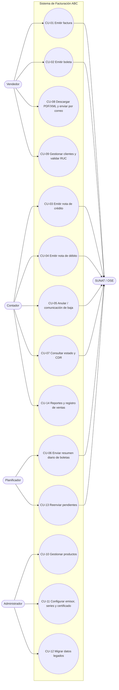

# 5. Casos de Uso

Fuente: funcionalidades habituales de software de facturación electrónica del mercado peruano (p. ej. Nubefact, usuario DEMO) y
quejas frecuentes de usuarios (rechazos por montos mal calculados, correlativos duplicados, caídas de conexión, dificultad para
anular). Cada caso se enlaza con reglas (RN), endpoints (EP) y normas (N).

## 1. Actores

| Actor | Descripción |
| :--- | :--- |
| Vendedor / Cajero | Emite boletas y facturas en tienda (Windows o Android) |
| Administrador | Configura emisor, series, certificado, usuarios, productos |
| Contador | Consulta estados, anula, emite notas, exporta registros |
| SUNAT / OSE | Sistema externo que valida y devuelve el CDR |
| Planificador | Proceso automático (reintentos, resumen diario) |

## 2. Diagrama

## 3. Catálogo de casos de uso

| ID | Caso de uso | Actor | Prioridad | Reglas | Endpoint |
| :--- | :--- | :--- | :---: | :--- | :--- |
| CU-01 | Emitir factura | Vendedor | Alta | RN-01..RN-12 | EP-01 |
| CU-02 | Emitir boleta de venta | Vendedor | Alta | RN-02..RN-08, RN-11 | EP-01 |
| CU-03 | Emitir nota de crédito (Cat. 09) | Contador | Alta | RN-03, RN-07, RN-08, RN-12 | EP-05 |
| CU-04 | Emitir nota de débito (Cat. 10) | Contador | Media | RN-03, RN-07, RN-08 | EP-05 |
| CU-05 | Anular comprobante (comunicación de baja) | Contador | Alta | RN-12 | EP-06 |
| CU-06 | Enviar resumen diario de boletas | Planificador | Alta | RN-05 | EP-07 |
| CU-07 | Consultar estado y CDR | Contador | Alta | — | EP-02, EP-03 |
| CU-08 | Descargar PDF / XML / CDR y enviar por correo | Vendedor | Media | — | EP-04 |
| CU-09 | Gestionar clientes y validar RUC/DNI | Vendedor | Alta | RN-01, RN-02 | EP-08, EP-09 |
| CU-10 | Gestionar productos (afectación IGV, ISC Cat. 08, ICBPER) | Administrador | Alta | RN-07 | EP-10 |
| CU-11 | Configurar emisor, series y certificado digital | Administrador | Alta | RN-01, RN-03 | EP-11, EP-12 |
| CU-12 | Migrar datos del software legado | Administrador | Alta | RN-13 | EP-13..EP-15 |
| CU-13 | Reenviar comprobantes pendientes (sin conexión) | Planificador | Alta | — | EP-16 |
| CU-14 | Reportes de ventas e inventario (registro de ventas, kardex) | Contador | Media | — | EP-17 |

## 4. Especificación de casos principales

### CU-01 Emitir factura

- **Precondiciones:** emisor configurado con certificado vigente; serie `F###` activa; usuario autenticado.
- **Flujo principal:**
  1. El vendedor busca o registra al cliente con RUC (CU-09); el sistema valida dígito verificador y estado en el padrón (RN-01/RN-02).
  2. Agrega ítems desde el catálogo de productos; el sistema propone unidad, afectación IGV, ISC (Cat. 08) e ICBPER.
  3. Elige moneda y forma de pago (contado / crédito con cuotas).
  4. El sistema calcula tributos y totales (RN-07, RN-08) y los muestra antes de confirmar.
  5. Al confirmar: asigna correlativo (RN-04), genera XML UBL 2.1 Perú, valida XSD y reglas SUNAT (RN-11), firma y envía al OSE/SUNAT.
  6. Recibe el CDR, actualiza el estado, registra la SALIDA de inventario y muestra el PDF con código QR.
- **Flujos alternos:**
  - 1a. RUC inválido o en estado BAJA/NO HABIDO → se bloquea la emisión (`DOC_CLIENTE_INVALIDO`, RN-02).
  - 5a. Sin conexión → estado `PENDIENTE_ENVIO`; el comprobante se entrega y CU-13 lo reenvía.
  - 6a. CDR de rechazo (2000–3999) → estado `RECHAZADO`, se muestran el código y el motivo; el correlativo no se reutiliza.
  - 6b. CDR con observaciones (≥ 4000) → `ACEPTADO_CON_OBS`.
- **Postcondición:** comprobante persistido con XML, hash y CDR; movimiento de inventario registrado.

### CU-02 Emitir boleta

Igual que CU-01 con serie `B###`; cliente opcional (tipo doc. `-` Varios) salvo que el importe supere el umbral (RN-06).
Puede enviarse individualmente o mediante el resumen diario (CU-06).

### CU-03 Emitir nota de crédito

- **Precondición:** documento afectado en estado `ACEPTADO` o `ACEPTADO_CON_OBS`.
- **Flujo:** el contador selecciona el comprobante, elige el motivo (Cat. 09: `01` anulación de la operación, `06` devolución total,
  `07` devolución por ítem, …), ajusta ítems/montos; el sistema referencia el documento (`cac:BillingReference`,
  `cac:DiscrepancyResponse`), firma y envía.
- **Alterno:** monto de la nota mayor que el del documento afectado → error de validación.

### CU-05 Anular comprobante

- **Factura:** comunicación de baja (`RA-AAAAMMDD-n`) mediante `sendSummary`, obtiene un ticket y luego consulta con `getStatus`.
- **Boleta:** se informa en el resumen diario con estado "anulado".
- **Regla:** solo comprobantes aceptados que no hayan sido entregados/utilizados; si no, debe emitirse una nota de crédito.

### CU-12 Migrar datos del software legado

- **Flujo principal:**
  1. El administrador carga el export del legado (CSV o conexión a su base de datos).
  2. El sistema calcula el hash del archivo; si ya existe un lote con ese hash, lo informa (idempotencia).
  3. Copia las filas a staging y ejecuta las validaciones (fechas, cantidades, producto vacío).
  4. Muestra una **vista previa** (dry-run): productos a crear, posibles duplicados, filas rechazadas.
  5. El administrador confirma; el sistema carga productos y movimientos con `OrigenLegacy`.
  6. Ejecuta la reconciliación (RN-13) y genera el reporte del lote.
- **Alternos:** 3a. Filas inválidas → se excluyen y se listan con su motivo; el lote termina `CON_ERRORES` si el administrador lo acepta.
  6a. Reconciliación fallida → el lote se revierte (`REVERTIDO`).

### CU-13 Reenviar pendientes

El planificador recorre `PENDIENTE_ENVIO` con *backoff* exponencial; reenvía **el mismo XML firmado** (no se vuelve a generar)
y alerta al administrador si un comprobante se acerca al plazo máximo de envío.

## 5. Requisitos derivados de opiniones de usuarios

| Problema reportado frecuentemente | Requisito / decisión |
| :--- | :--- |
| Rechazos por diferencias de redondeo en totales | Motor de cálculo único en el dominio (RN-07/RN-08) con pruebas de propiedades |
| Correlativos duplicados al usar varias cajas | Bloqueo transaccional por serie; una serie por dispositivo |
| El sistema se detiene sin internet | Cola de pendientes (CU-13) |
| Anular es confuso (baja vs. nota de crédito) | Asistente que decide el mecanismo según tipo y estado |
| Cliente no recibe el comprobante | Envío automático por correo + enlace de consulta |
| Errores de SUNAT ininteligibles | Traducción de códigos de error a mensajes con la acción sugerida |
